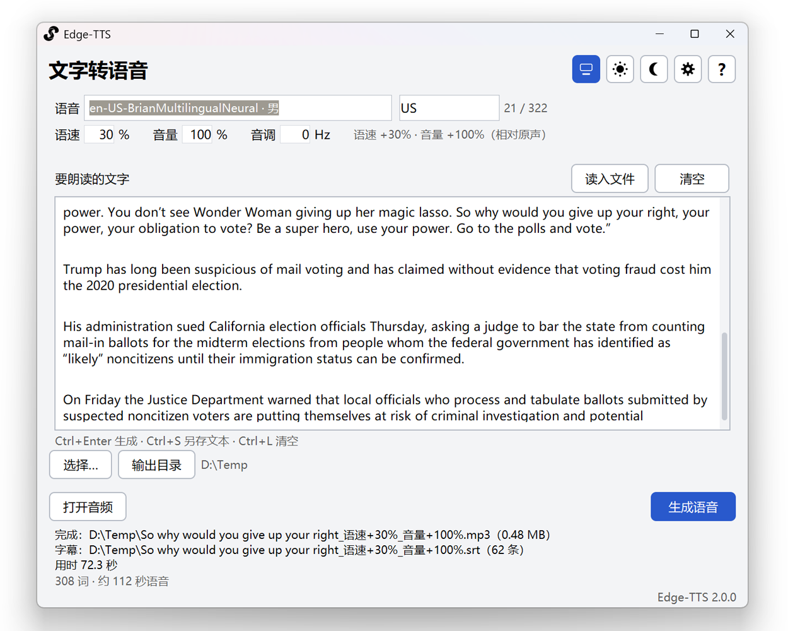
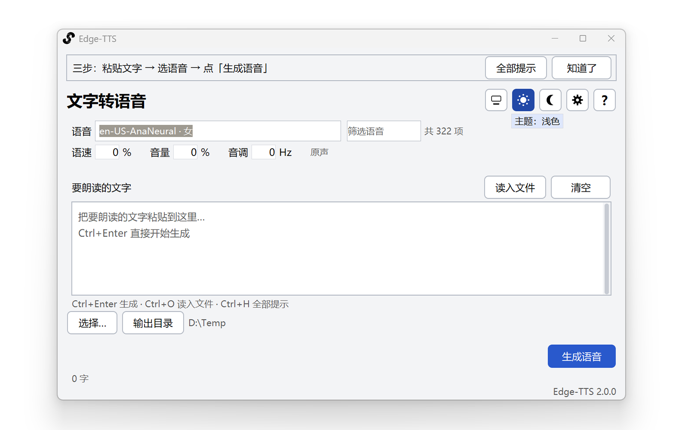
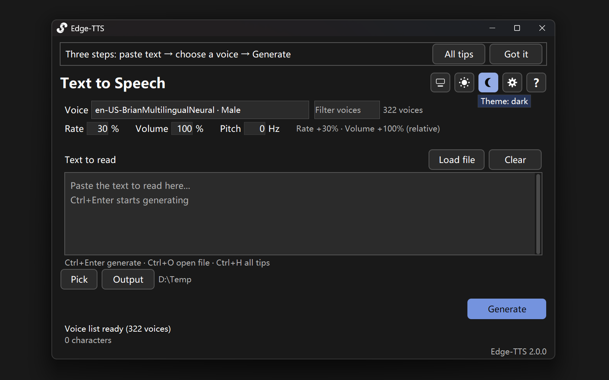

# :radio: GUI-of-Edge-TTS

<div align="center">


[**简体中文**](README.md) · [English](README.en.md)



<br>


<sub>v1.0 → v2.0 S1 → v2.0 S2 → 最终版</sub>

</div>

## :earth_asia: 它是什么

把文字变成语音，同时生成一份逐词对齐的 `.srt` 字幕——**用来练口语**。
把文字粘贴进去、选一个声音、点一下就开始；生成的文件在同一个文件夹里，
音频和字幕同名，播放器会自动加载字幕。

**界面跟随系统主题。** 浅色与深色两套配色，也可以手动锁定其中一种。

| 浅色 | 深色 |
|---|---|
|  |  |

<br>

## :rocket: 快速开始

1. 到 [Releases](https://github.com/Neus117/GUI-of-Edge-TTS/releases) 下载 `GUI-of-Edge-TTS.exe`
2. 双击运行（免安装）
3. 粘贴文字 → 选语音 → 点「生成语音」

首次运行会出现一条使用提示，点「知道了」收起；之后点右上角的「?」或按 `Ctrl+H` 随时可以再看。

<br>

## :sparkles: 功能

### 1.0 就有的

| 功能 | 说明 |
|---|---|
| **文字转语音** | 上游是微软 Edge 的在线语音服务，生成 `.mp3` |
| **逐词字幕** | 同时生成 `.srt`，每块最多 5 个词；2.0 进一步保证不跨句、不跨长停顿 |

### 2.0 相对 1.0 的变化

| 功能 | 说明 |
|---|---|
| **新图标系统** | 应用、任务栏、标题栏图标全部重制；README 顶部展示 v1.0 → S1 → S2 → 最终版的演进 |
| **深浅主题** | 跟随系统，或手动锁定浅色 / 深色；标题栏、滚动条、下拉列表、设置和帮助一起变 |
| **中文 / English** | 默认跟随 Windows 界面语言；设置里切换立即生效并记住 |
| **界面重做** | 主窗口更大、编辑区更宽；面板统一底色，按钮共用一套外观，间距和抗锯齿重新做过 |
| **语音筛选** | 322 个语音加筛选框；输入 `en 女`、`zh-CN`、`晓晓` 都能过滤 |
| **语速 / 音量 / 音调** | 1.0 没有这三个参数；现在可填 `20`、`+20%`、`1.2x`，并实时显示“原声/已调整” |
| **输出目录** | 可在设置里选默认目录并记住；主界面直接显示当前输出目录 |
| **生成进度与取消** | 不再是无意义的来回进度条；显示已生成秒数和已接收字节，可取消，**取消后不留半截文件** |
| **结果直接可用** | 完成后状态栏给出音频/字幕完整路径和「打开音频」「所在文件夹」，不再弹挡住的成功框 |
| **使用提示** | 首次运行顶部提示条、编辑区下方快捷键提示、右上角「?」完整帮助；重新打开提示时窗口会长高，不裁页脚 |
| **读入 / 另存文本** | `Ctrl+O` 读 `.txt`/`.md`/`.srt`（UTF-8 失败自动试 GBK）；`Ctrl+S` 另存 |
| **智能默认文件名** | 从文字里本地提取标题，带语速/音量/音调后缀，仍可改名 |
| **设置窗口** | 代理、提示开关、配置文件位置、界面语言；改完立即生效并落盘 |
| **记住偏好** | 上次的语音、参数、输出目录都会恢复 |
| **窗口稳定性** | 设置窗口固定尺寸，切语言不缩不黑；帮助/设置弹窗冻结显示；提示条重新出现时主窗口同步长高 |
| **错误处理** | 网络/代理错误写进状态栏，不弹一堆对话框；坏配置改名 `.bad` 后用默认值继续 |

<br>

## :keyboard: 快捷键

| 快捷键 | 作用 |
|---|---|
| `Ctrl+Enter` | 开始生成 |
| `Ctrl+O` | 读入文本文件 |
| `Ctrl+S` | 把编辑区内容另存为文本文件 |
| `Ctrl+L` | 清空编辑区 |
| `Ctrl+H` | 使用提示（等同点右上角的「?」） |
| `Esc` | 取消生成 / 关闭提示窗口 |

<br>

## :inbox_tray: 使用说明

| | |
|---|---|
| **下载** | 到 [Releases](https://github.com/Neus117/GUI-of-Edge-TTS/releases) 下载 `GUI-of-Edge-TTS.exe`，双击即用，无需安装 |
| **文件落在哪** | 点「生成语音」时由你选；默认是「音乐」文件夹（可在设置里改）。选 `xxx.mp3` 就会在同一目录生成同名的 `xxx.srt` |
| **设置存在哪** | `%APPDATA%\GUI-of-Edge-TTS\settings.json`。文件坏了不会让程序起不来——坏的那份改名成 `settings.json.bad` 留档，程序用默认值继续 |
| **卸载** | 删掉 exe、删掉上面那个设置文件夹即可，不留别的东西 |
| **查看版本** | `GUI-of-Edge-TTS.exe --version` → 打印形如 `Edge-TTS 2.0.0+ae4a6f4`，`+` 后面是构建它的提交 |
| **不联网能用吗** | 不能。语音由微软的在线服务合成；网络不通时状态栏会说明原因 |

<br>

## :warning: 已知限制

| 限制 | 状态 |
|---|---|
| **必须联网** | 上游是在线合成，没有离线模式 |
| **按钮不是真圆角** | Tk 画不出圆角；视觉规范里的 `radius_button = 8` 在这一版用「1 像素描边 + 留白」代替。**这是取舍不是做不到**——自绘圆角要重写按钮、输入框与焦点环，风险大于收益 |
| **原生对话框跟随系统主题** | 保存／打开文件的对话框由 Windows 绘制。程序会同步它的标题栏深浅，但对话框内部跟随系统设置，不跟随本程序的浅色/深色开关 |
| **中文标点会被换掉** | 生成前把 `。，！？` 等换成英文标点，因为上游对全角标点的断句质量更差。字幕里因此是英文标点 |
| **一次生成一份音频** | 不做批量队列；要生成多份就多跑几次 |
| **语音列表要联网拉取** | 拉不到时退到内置的 4 个常用语音，并在状态栏说明「列表未加载」——**不会假装那是全部** |

<br>

## :wrench: 依赖

| 依赖 | 版本 | 为什么是这个版本 |
|---|---|---|
| Python | 3.12 | `environment.yml` 里钉的版本；代码本身兼容 3.10+ |
| tkinter | 随 Python | 界面框架，conda 的 python 自带 |
| **edge-tts** | **7.3.1** | **不能退回 7.0.0**：7.3.x 起上游自带 SRT 合成（`edge_tts.srt_composer`），不再依赖外部 `srt` 包 |
| PyInstaller | 6.22.3 | 打包成单文件 exe |

```bash
conda env create -f environment.yml -p "<你的路径>\edge-tts-env"
conda activate "<你的路径>\edge-tts-env"
```

<br>

## :books: 文档

| 文档 | 面向 |
|---|---|
| [README.md](README.md) / [README.en.md](README.en.md) | 用户——这是什么、怎么装、怎么用、有什么限制 |
| [docs/DEVELOPMENT.md](docs/DEVELOPMENT.md) | 维护者——架构、这一版改了什么、判据怎么来的、遗留 |
| [tools/README.md](tools/README.md) | 维护者——每个工具查的是什么缺陷 |

<br>

## :computer: 开发者

### 跑起来

```bash
python src/GUI-of-Edge-TTS.py              # 起界面
python src/GUI-of-Edge-TTS.py --selftest   # 不创建窗口的自检（15 项）
python src/GUI-of-Edge-TTS.py --version    # 版本 + 构建提交
python src/GUI-of-Edge-TTS.py --help       # 全部命令行选项
```

### 门禁

```bash
python tools/check_all.py            # 全部（含联网的端到端冒烟）
python tools/check_all.py --offline  # 跳过联网那一项
```

| 检查 | 查的是什么缺陷 |
|---|---|
| `add_bom.py --check` | `.ps1` 少 UTF-8 BOM ⇒ Windows PowerShell 5.1 按 GBK 解码，中文变假语法错误 |
| `--selftest` | 参数解析、字幕合成、主题、设置读写这些纯逻辑的回归 |
| `unittest discover -s tests -t tests` | 164 条用例，不依赖窗口、不联网 |
| `check_forbidden.py` | 写死的绝对路径、写死的颜色、同一个类里重复定义的方法、没人读的设置字段 |
| `ui_layout_probe.py` | 控件被挤出客户区、卡片与底色同色、间距离开 4 像素网格 |
| `e2e_smoke.py` | **走用户真实走的那条路**（联网）：真实控件 → 真实生成按钮 → 真实事件循环 → 磁盘上真有 mp3 和 srt |

**门禁自己也要验。** `check_forbidden.py --self-test` 会造一批必然被拦的样本
确认它真的会报，再造阴性样本确认它不会误报。理由很实在：
**「返回通过」和「根本没有检查这一项」在输出里长得一模一样。**

### 代码结构

```
src/GUI-of-Edge-TTS.py        入口（把 src 放进 sys.path，交给包）
src/gui_of_edge_tts/
  bootstrap.py      命令行、--selftest、创建窗口
  ui.py             唯一碰 tkinter 的模块：布局、提示、操作与展示逻辑
  theme.py          配色与尺寸：深浅两套调色板、逻辑像素换算、ttk 样式
  platform_win.py   Windows 细节：主题检测、DPI、深色标题栏、资源路径
  engine.py         合成引擎：可取消、先写临时文件再改名
  voices.py         语音目录：排序、搜索语法、兜底清单
  subtitles.py      WordBoundary → SRT（合并规则在这里，可单独测）
  params.py         语速/音量/音调的解析与校验
  text.py           文本预处理与字数统计
  lang.py           中英界面语言：L()、系统检测、设置持久化
  settings.py       设置的读写（原子写、坏文件降级）
  version.py        版本与构建提交
tests/              164 条单元测试
tools/              门禁、探针、截图与端到端冒烟
```

**分层是为了让判断可以自动验证。** 文本预处理、字幕合并规则、参数解析、
语音排序这些以前埋在窗口回调里的逻辑，现在都在不依赖 tkinter 的模块里，
由 `tests/` 覆盖；`ui.py` 只负责"把它们接起来并显示出来"。

### 打包

```powershell
powershell -ExecutionPolicy Bypass -File build.ps1
```

`build.ps1` 会：跑门禁 → 把当前提交哈希写进包里（这样产物能自报是哪个提交构建的）
→ 调用 PyInstaller → **运行产物的 `--version` 并核对它自报的提交与本次构建一致**。
最后一步不能省：「我以为我写进去了」和「它真的在里面」是两件事。

<br>

## :handshake: 贡献

Issue 与 Pull Request 都欢迎。改界面之前请先读
[tools/README.md](tools/README.md)——里面有每个探针"当时是怎么知道的"。

<br>

## :page_facing_up: 许可与商标

- 本项目以 GPL-3.0 授权，见 [LICENSE](LICENSE)。
- 语音合成由微软 Edge 的在线服务提供，与本项目无隶属关系。
- 上游库是 [rany2/edge-tts](https://github.com/rany2/edge-tts)。
